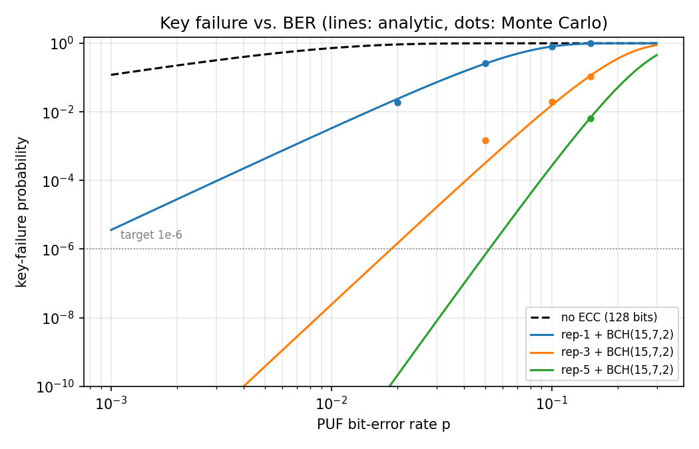
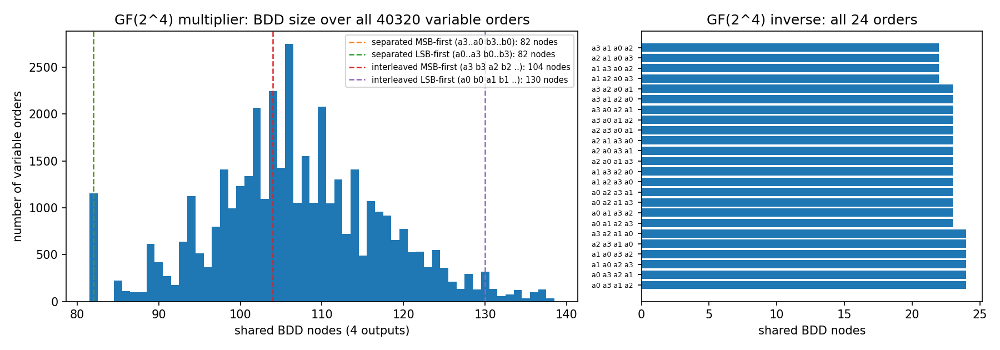

# Ring-Oscillator PUF Key Generator with Fuzzy Extractor: Progress Report

> **Project:** P4, Hardware Security
> **Platform:** Digilent Zybo Z7-10 (Zynq-7010, `xc7z010clg400-1`), Vivado 2024.2
> **Team:** 2 members. Workstream A (RO array) could not continue on the FPGA, so from 14 November all phases, including the RO array, were completed by Workstream B on the board.
> **Last updated:** 15 November 2026

**Aim:** generate a stable, device-unique cryptographic key from ring-oscillator variation on the FPGA, using a fuzzy extractor (repetition code + BCH(15,7,2)) to correct the noise. The key is used only internally, for a keyed MAC, and is never readable over the bus.

Supporting documents:

| Document | Contents |
|----------|----------|
| [`docs/Implementation_Plan.md`](docs/Implementation_Plan.md) | Full plan: objectives, architecture, phases, risks |
| [`model/README.md`](model/README.md) | Golden model in detail: files, test vectors, plots |
| [`docs/Glossary.md`](docs/Glossary.md) | Every technical term explained simply |
| [`docs/ESPRESSO_Setup.md`](docs/ESPRESSO_Setup.md) | How ESPRESSO was built and how to run the flow |
| [`docs/Phase4_BCH_HLS.md`](docs/Phase4_BCH_HLS.md) | BCH decoder hand HLS: DFG, schedules, binding, results |
| [`docs/Phase5_Fuzzy_Extractor.md`](docs/Phase5_Fuzzy_Extractor.md) | Fuzzy extractor in hardware: SipHash, datapath, sequencer, lock, verification |
| [`docs/Phase2_8_9_PUF_Hardware.md`](docs/Phase2_8_9_PUF_Hardware.md) | RO-PUF on the board: placement, route locking, characterisation, configurable-RO research |
| [`docs/Phase6_SoC.md`](docs/Phase6_SoC.md) | RV32I SoC, firmware, JTAG mailbox, on-board demo results |
| [`docs/Phase7_CTL_Proofs.md`](docs/Phase7_CTL_Proofs.md) | CTL model checking of the sequencer, mutants, RTL conformance |
| [`docs/Live_Demo_Guide.md`](docs/Live_Demo_Guide.md) | **Step-by-step live demo:** board setup, enrolment, authentication, impostor test, lock, troubleshooting |

---

## 1. Status at a glance

| Phase | Work | Owner | Status |
|-------|------|-------|--------|
| 0 | Setup: repository structure, toolchain, specification | Both | ✅ Done |
| 1 | Golden model (Python): GF(2⁴), BCH, repetition, fuzzy extractor, SipHash, analysis, test vectors | B | ✅ Done |
| 2 | RO array with Pblock/LOC constraints + measurement counters | B | ✅ Done (on the board) |
| 3 | GF(2⁴) multiplier/inverse via ESPRESSO + BDD verification + synthesis comparison | B | ✅ Done |
| 4 | BCH syndrome + Peterson decoder with hand HLS (1 vs. 2 GF multipliers) | B | ✅ Done |
| 5 | Fuzzy-extractor datapath + sequencer FSM + enrolment lock (incl. SipHash core) | B | ✅ Done |
| 6 | RV32 SoC, challenge–response firmware | B | ✅ Done (on the board) |
| 7 | CTL proofs (key valid only after ECC, no enrolment after lock) | B | ✅ Done |
| 8 | Characterisation (3 virtual devices on 1 board, ≥ 100 reads, warm test) | B | ✅ Done |
| 9 | Research enhancement (configurable ROs) | B | ✅ Done |
| 10 | Demo and final report | B | ✅ Demo works on the board. Final report material is in `docs/` |

### Objectives

| ID | Objective | Status |
|----|-----------|--------|
| O1 | Placed RO array (128–256 ROs, Pblock/LOC) | ✅ 3 × 256 configurable ROs: LOC/BEL/LOCK_PINS, Pblock with exclusion, **locked routes** (2,304/2,304 nets verified) |
| O2 | Counter-based pairwise measurement → 128-bit response | ✅ Two gated counters per pair, 8.6 ms per response, SELECT mode for the configurable RO |
| O3 | Golden model of the fuzzy extractor (encode, add noise, decode) | ✅ Done: 32 tests pass, vectors exported |
| O4 | GF(2⁴) multiplier/inverse as an ESPRESSO/BDD block | ✅ Done: generated, proven equivalent, simulated and synthesised |
| O5 | BCH syndrome + Peterson locator via hand HLS, 1 vs. 2 multipliers | ✅ Done: both decoders pass all 17,488 vectors, area/latency compared |
| O6 | Code-offset fuzzy extractor (repetition ∘ BCH) | ✅ Done: RTL matches the model for r = 1, 3, 5, meets 125 MHz after routing |
| O7 | Enrol/reconstruct/measure sequencer FSM + one-time lock | ✅ Done: lock, rejection and zeroisation verified (formal proofs in Phase 7) |
| O8 | CTL proofs | ✅ P1 `AG(key_valid → ecc_ok)` and P2 `AG(locked → AG ¬enrol)` hold, plus 5 more. 3 mutants caught. RTL conformance 0 mismatches |
| O9 | RV32 SoC + challenge–response; key not bus-readable | ✅ Own RV32I core + firmware. Helper data in SoC RAM. No address for the key. Runs at 125 MHz on the board |
| O10 | Uniqueness, reliability, bit-aliasing, key-failure rate on ≥ 3 boards | ✅ Uniqueness 48.9% (pooled), BER 0.2–3.3%, warm test +7 °C, ECC failures 0/1,800. **3 virtual devices on 1 board** (see note) |
| O11 | Research paper implementation and comparison | ✅ Configurable RO (Maiti & Schaumont): **0 bit errors in 1,800 reads** against 0.2–3.3% BER for the baseline, at zero extra LUTs |
| O12 | Demo: enrolled board passes, other board fails | ✅ On the board: device 0 **AUTHENTICATED** 4/4, devices 1 and 2 **REJECTED**, 100/100 reliable reconstructions |

---

## 2. Phase 1: Golden model (completed)

A Python reference version of the complete key generator. The hardware must match it bit for bit. Full details are in [`model/README.md`](model/README.md).

**Highlights:**
- **Modules:** GF(2⁴) arithmetic, BCH(15,7,2) encoder and decoder (syndromes, Peterson, Chien search), repetition code, code-offset fuzzy extractor with a key-check value, SipHash-2-4 MAC/KDF, noise models, a PUF board simulator, and PUF metrics.
- **Verification:**
  - BCH decoding tested exhaustively on all 128 codewords × all 121 error patterns of weight ≤ 2.
  - SipHash checked against the official test vectors.
  - Monte Carlo agrees with the analytic failure model.
- **RTL test vectors:** `gf_mul.mem`, `gf_inv.mem`, `bch_enc.mem`, `bch_dec.mem` (17,488 vectors with every intermediate value), and `fe_r1/3/5.mem` (end-to-end, including the "other board" failure cases).
- **Design result: choosing the repetition factor.** For a key-failure target of 10⁻⁶, BCH alone (r = 1) tolerates only a 0.07% bit-error rate. r = 3 tolerates 1.87%, and r = 5 tolerates 5.21%. Typical RO-PUFs have 1–5% BER, so r = 3 or more is likely needed. The final choice waits for the measured BER from Phase 2.



---

## 3. Phase 3: GF(2⁴) arithmetic via ESPRESSO and BDD (completed)

The BCH decoder (Phase 4) needs a GF(2⁴) multiplier and inverse. The project asks for them to be built as an **ESPRESSO/BDD block**: minimise the logic with ESPRESSO, then verify it with binary decision diagrams.

### 3.1 Flow

```
 golden model ──► truth tables (.pla) ──► ESPRESSO ──► minimised cover (.min.pla)
 (gf16.py)          256 / 16 rows        (exact mode)         │
                                                              ├──► Python check, all inputs
                                                              ├──► ROBDD equivalence proof
                                                              └──► Verilog (rtl/gf/*_sop.v)
                                                                      │
                     Mastrovito XOR multiplier (rtl/gf/gf16_mul_xor.v) ─┤
                                                                      ├──► xsim testbench (all inputs)
                                                                      └──► Vivado synthesis (LUTs, levels)
```

**Tools:**
- **ESPRESSO:** built from source (`classabbyamp/espresso-logic`), with three small patches for Windows/MinGW. See [`docs/ESPRESSO_Setup.md`](docs/ESPRESSO_Setup.md).
- **BDD package:** written ourselves, in [`model/bdd.py`](model/bdd.py). It is an ROBDD with a unique table and the ITE operation.
- **Vivado 2024.2:** used for simulation (xsim) and out-of-context synthesis.

### 3.2 ESPRESSO minimisation

| Function | Inputs → outputs | Truth-table rows with output 1 | Heuristic: terms / literals | **Exact: terms / literals** |
|----------|------------------|-------------------------------|-----------------------------|-----------------------------|
| Multiplier a·b | 8 → 4 | 225 | 135 / 810 | **129 / 781** |
| Inverse a⁻¹ | 4 → 4 | 15 | 15 / 51 | **14 / 50** |

**Observation:** the inverse minimises well, but the multiplier stays large. Each product bit is an XOR of 4–7 terms aᵢbⱼ, and XOR is the worst case for two-level AND-OR logic: an n-input XOR needs 2ⁿ⁻¹ product terms. So ESPRESSO isn't performing badly here; the multiplier simply isn't suited to sum-of-products form.

### 3.3 Verification (three independent checks)

| Check | Method | Result |
|-------|--------|--------|
| Python | The minimised cover is evaluated on every input and compared with the golden model | ✅ 256/256 and 16/16 |
| **BDD equivalence** | The truth table, the ESPRESSO cover and the Mastrovito equations are each built as an ROBDD in one shared manager. Because ROBDDs are canonical, equal functions must be the *same node* | ✅ All 4 outputs of each function are the same node: **proven equivalent** |
| RTL simulation | `tb/tb_gf16_sop.v` in Vivado xsim, exhaustive, against `gf_mul.mem` / `gf_inv.mem` | ✅ `PASS: gf16_mul_sop, gf16_mul_xor (256/256) and gf16_inv_sop (16/16)` |

The BDD checker was itself tested: changing a single truth-table entry produces a different node (`model/tests/test_bdd.py`).

### 3.4 BDD variable-ordering study

The size of a BDD depends on the order in which variables are tested. We computed the shared BDD size for **every possible order**: 8! = 40,320 for the multiplier and 4! = 24 for the inverse.



| Function | Order | Shared BDD nodes |
|----------|-------|------------------|
| Multiplier | **Best: all a-bits first, then all b-bits** (e.g. a3 a2 a1 a0 b3 b2 b1 b0) | **82** |
| Multiplier | Interleaved, MSB first (a3 b3 a2 b2 …) | 104 |
| Multiplier | Interleaved, LSB first (a0 b0 a1 b1 …) | 130 |
| Multiplier | Worst (a0 b2 b1 b0 a1 a3 a2 b3) | 138 |
| Multiplier | Median over all orders | 106 |
| Inverse | Best (e.g. a3 a1 a0 a2) / worst (e.g. a3 a2 a1 a0) | 22 / 24 |

**Observations:**
- **Separating the operands is optimal.** Once all bits of a are fixed, the multiplier becomes "multiply b by a constant", which is a *linear* function: each output is just an XOR of some b-bits. An XOR chain has a tiny BDD. Exactly 2 × 4! × 4! = **1,152 orders** reach the minimum of 82 nodes: every order that puts all a-bits first, or all b-bits first.
- **Interleaving, often the best choice for adders, is worse here**, because the multiplier mixes every aᵢ with every bⱼ.
- **Sharing matters.** Each output alone needs 37 nodes (148 in total), but the four outputs share sub-graphs, giving 82.
- The inverse is a small 4-input function, so ordering barely matters (22–24 nodes).

A drawable BDD of the inverse is saved as `docs/figures/bdd_gf_inv.dot`. Render it with Graphviz or any online Graphviz viewer.

### 3.5 FPGA synthesis comparison (Vivado, Zynq-7010, out-of-context)

| Module | LUTs | LUT levels | Path delay (estimate) |
|--------|------|-----------|------------------------|
| `gf16_mul_sop` (ESPRESSO SOP) | 16 | 2 | 3.31 ns |
| `gf16_mul_xor` (Mastrovito) | **8** | 2 | 3.17 ns |
| `gf16_inv_sop` (ESPRESSO SOP) | 4 | 1 | 2.07 ns |

These are post-synthesis estimates for the logic only, without I/O buffers. Full reports are in `docs/reports/synth_gf/`.

**Observations:**
- **The SOP multiplier uses twice the LUTs of the XOR version.** Two-level minimisation is the right goal for PLAs and two-level ASIC logic. On an FPGA, the XOR structure maps better onto 6-input LUTs, and Vivado can't fully recover that structure once the logic has been flattened into 129 product terms.
- **The inverse is ideal for SOP/LUT:** each output depends on only 4 inputs, so it is exactly one LUT, giving 4 LUTs and a single logic level.
- **Design decision for Phase 4:**
  - Use `gf16_inv_sop` as the inverse.
  - Instantiate the multiplier through a single wrapper, so that `gf16_mul_sop` (the required ESPRESSO block) and `gf16_mul_xor` (the more efficient one) can be swapped and compared inside the BCH decoder.

### 3.6 Files produced in Phase 3

| File | Contents |
|------|----------|
| `model/vectors/espresso/gf_mul.min.pla`, `gf_inv.min.pla` | ESPRESSO output (minimised covers) |
| `rtl/gf/gf16_mul_sop.v`, `rtl/gf/gf16_inv_sop.v` | Generated sum-of-products Verilog |
| `rtl/gf/gf16_mul_xor.v` | Hand-written Mastrovito multiplier (reference) |
| `tb/tb_gf16_sop.v` | Exhaustive self-checking testbench |
| `model/bdd.py`, `model/tests/test_bdd.py` | Our ROBDD package and its tests |
| `scripts/espresso_flow.py` | ESPRESSO → check → Verilog flow |
| `scripts/bdd_flow.py` | BDD equivalence and ordering study |
| `scripts/synth_gf.tcl` | Vivado batch synthesis comparison |
| `docs/figures/bdd_ordering.png`, `bdd_gf_inv.dot` | BDD figures |
| `docs/reports/phase3_bdd.txt`, `docs/reports/synth_gf/` | Raw results |

---

## 4. Phase 4: BCH decoder by hand HLS (completed)

The BCH decoder corrects up to 2 flipped bits per 15-bit block in three steps: syndromes, Peterson error locator, and Chien search. We scheduled it by hand onto **1** and onto **2** GF(2⁴) multipliers.

The full design record is in [`docs/Phase4_BCH_HLS.md`](docs/Phase4_BCH_HLS.md): data-flow graphs, ASAP/ALAP, schedules, binding, register allocation and state machines.

### 4.1 Hand-HLS design

- **Algebraic transformation first.** The textbook form Λ2 = (S3 + S1³)/S1 is a chain of 3 multiplications, so it takes 3 steps however many multipliers are available. Rewritten as **Λ2 = S3·S1⁻¹ + S1²**, it has two *independent* products: 1 step with 2 multipliers, 2 steps with 1.
- **No multipliers elsewhere.** The syndromes are XOR networks, and the Chien constants α⁻ⁱ and α⁻²ⁱ come from a lookup table.
- **Schedules:**

| | 1 GF multiplier (`bch_dec_1mul`) | 2 GF multipliers (`bch_dec_2mul`) |
|---|---|---|
| Syndromes | 1 cycle | 1 cycle |
| Peterson | 2 cycles (S1², then S3·S1⁻¹) | 1 cycle (both in parallel) |
| Chien search | 30 cycles (2 per position) | 15 cycles (1 per position) |
| Check | 1 cycle | 1 cycle |
| **Latency** | **34 cycles, constant** | **18 cycles, constant** |
| Extra registers | `acc` + `phase` (5 FFs) | – |

- **Constant-time.** The latency doesn't depend on the error pattern, so timing reveals nothing about the errors. The S1 = 0 case falls out of the datapath without a separate branch.

### 4.2 Verification

`tb/tb_bch_dec.v` runs all four configurations (1 or 2 multipliers × ESPRESSO or XOR multiplier) on all **17,488** vectors. It checks every intermediate value: S1, S3, Λ1, Λ2, the error mask, the corrected word and `ok`.

| Configuration | Latency | Mismatches |
|---|---|---|
| 1 multiplier, ESPRESSO | 34 | 0 |
| 1 multiplier, XOR | 34 | 0 |
| 2 multipliers, ESPRESSO | 18 | 0 |
| 2 multipliers, XOR | 18 | 0 |

**Mutation test:** a deliberately broken Λ2 update was caught from the second vector onwards, with the faulty stage pinpointed.

### 4.3 Synthesis (Zynq-7010, each block kept as a separate resource)

| Decoder | Multiplier | LUTs | FFs | f_max (estimate) | Decode time | LUTs × ns |
|---|---|---|---|---|---|---|
| 1 multiplier | ESPRESSO | 110 | 62 | 158.5 MHz | 214.5 ns | 23,595 |
| 2 multipliers | ESPRESSO | 125 | 57 | 161.8 MHz | 111.2 ns | **13,900** |
| 1 multiplier | XOR | 101 | 62 | 171.1 MHz | 198.7 ns | 20,069 |
| 2 multipliers | XOR | 107 | 57 | 165.0 MHz | 109.1 ns | **11,674** |

**Findings:**
- **2 multipliers are the better design.** Halving the latency costs only 6–15 LUTs, and the area × time product drops by about 40%.
- **Sharing saves less than one multiplier.** Sharing a small 16-LUT GF(2⁴) multiplier needs 4-way operand multiplexers and extra registers, which use up most of the saving. Sharing pays off only for large units, such as multipliers in big fields.
- **Flattening distorts the SOP design.** With Vivado's default flattening, the 1-multiplier ESPRESSO decoder grows to 243 LUTs, because the 129-term SOP gets merged with its operand multiplexer. The XOR multiplier is unaffected. This confirms the Phase 3 finding that two-level SOP logic doesn't suit LUT fabric.
- **Speed is not a concern.** All configurations exceed the 125 MHz system clock, and a full key decodes in about 1–2 µs, against a PUF measurement of milliseconds.
- **Choice for Phase 5:** `bch_dec_2mul`.

### 4.4 Files produced in Phase 4

| File | Contents |
|------|----------|
| `rtl/ecc/bch_syndrome.v`, `rtl/ecc/bch_chien_x.v` | Syndrome XOR network, Chien lookup table |
| `rtl/ecc/bch_dec_1mul.v`, `rtl/ecc/bch_dec_2mul.v` | The two hand-scheduled decoders |
| `rtl/gf/gf16_mul.v` | Multiplier wrapper (`USE_SOP` selects ESPRESSO or XOR) |
| `tb/tb_bch_dec.v` | Self-checking testbench, 4 DUTs × 17,488 vectors |
| `scripts/synth_bch.tcl` | Synthesis of all 8 configurations (hierarchical and flat) |
| `docs/Phase4_BCH_HLS.md`, `docs/reports/synth_bch/` | Design record and raw reports |

---

## 5. Phase 5: Fuzzy extractor in hardware (completed)

The complete hardware key generator. It turns a noisy 128-bit PUF response plus public helper data into a stable 128-bit key that never leaves the module. Full design record: [`docs/Phase5_Fuzzy_Extractor.md`](docs/Phase5_Fuzzy_Extractor.md).

### 5.1 What was built

| Block | File | Role |
|-------|------|------|
| SipHash-2-4 core | `rtl/crypto/siphash24.v` | One core for the key derivation (KDF), the key-check value and the MAC |
| BCH encoder | `rtl/ecc/bch_enc.v` | Codewords for enrolment |
| Repetition codec | `rtl/ecc/rep_codec.v` | Repetition encoder and majority decoder, parameter REP = 1/3/5 |
| Fuzzy extractor | `rtl/fe/fuzzy_extractor.v` | Datapath, sequencer FSM, one-time lock and MAC. Reuses `bch_dec_2mul` from Phase 4 |

**How it works:**
- **ENROL:** measure the PUF, compute helper = response ⊕ codeword, derive the key, store the key-check value, wipe the key, and lock.
- **RECONSTRUCT:** measure the PUF, take a majority vote, decode each BCH block, rebuild the exact response, derive the key, then compare the key-check value. `key_valid` is set only if everything succeeds.
- **MAC:** answer a challenge, only while `key_valid` is set.

**Security rules built in:**
- ENROL is rejected once locked. The lock is sticky, and at reset it is reloaded from `boot_locked`.
- `key_valid` is set only after BCH succeeded on every block *and* the key-check value matched.
- There is no MAC without a valid key.
- The key and the response never appear on any port. Secret-derived registers are wiped after every command.
- Raw responses are visible only in a separate characterisation build.

### 5.2 Verification

| Testbench | What | Result |
|-----------|------|--------|
| `tb_siphash24` | 278 vectors: 64 reference, 200 random, 14 design messages. Latency 3B + 5 | ✅ PASS |
| `tb_ecc_blocks` | BCH encoder (128/128), repetition codec (every input) | ✅ PASS |
| `tb_fuzzy_extractor`, REP = 1, 3, 5 | 24 full life cycles each: enrol → refused re-enrol → refused MAC → reconstruct → MAC, plus a wrong-KCV case and a boot-time lock. Helper, KCV, key and tag are compared bit for bit with the golden model | ✅ PASS (all 3) |

**Mutation tests:** removing the lock check is caught on vector 0. Removing the key-check comparison is caught, but *only* by the dedicated wrong-KCV test, because the model vectors never contain an ECC success with a wrong key.

### 5.3 Synthesis and timing (Zynq-7010, 125 MHz)

| REP | LUTs | FFs | Device LUT % | Slack after place and route | RECONSTRUCT latency |
|-----|------|-----|--------------|-----------------------------|---------------------|
| 1 | 1,519 | 1,460 | 8.6% | **+0.259 ns** ✅ | 213 cycles (1.7 µs) |
| 3 | 1,306 | 1,145 | 7.4% | **+0.459 ns** ✅ | 87 cycles (0.7 µs) |
| 5 | 1,233 | 1,063 | 7.0% | not run (+0.786 ns after synthesis) | 67 cycles (0.5 µs) |

**Design iteration:** the first SipHash core chained the message XOR and the tag XOR into its rounds. It met timing on its own, but failed by 0.54 ns inside the fuzzy extractor. Moving those XORs into their own cycles made every round register-to-register and fixed timing for every configuration, at a cost of a few cycles per message. SipHash takes 56–66% of the LUTs.

---

## 6. On the board: PUF, SoC and demo (Phases 2, 6, 8, 9, 10)

Everything below was measured on the Zybo Z7-10 over JTAG. Details are in [`docs/Phase2_8_9_PUF_Hardware.md`](docs/Phase2_8_9_PUF_Hardware.md) and [`docs/Phase6_SoC.md`](docs/Phase6_SoC.md).

### 6.1 RO-PUF hardware

- **3 arrays × 256 configurable ROs** (≈ 290 MHz), at three heights of the die.
- One RO per slice: 3 LUT stages + a toggle flip-flop. Pairs sit in vertically adjacent slices.
- **Fully pinned down:** LOC/BEL/LOCK_PINS and an exclusive Pblock.
- **Measurement:** two gated counters per pair, 2¹³-cycle window, 8.6 ms per 128-bit response.
- **Configurable RO** (research): each LUT stage chooses between two input pins, giving 8 paths per RO at **zero extra LUTs**. A SELECT mode picks the most stable path per pair at enrolment.

**Key engineering finding: the PUF changed with every rebuild.** A rebuild changed **17–21% of the response bits**: the router re-wires each RO's internal loop, and an RO's frequency moved by up to 20.6%. The fix: the routes of all 2,304 RO nets are exported from the reference SoC build and applied as `FIXED_ROUTE` to every build. A check confirms 2,304/2,304 identical nets. A rebuild test with locked routes still changed **7–10%** of the bits: each RO now moves only 0.2% (down from up to 20.6%), but the changed *surroundings* still flip the closest pairs. **The PUF is therefore tied to its bitstream.** Firmware changes after enrolment must use `updatemem`, not a rebuild.

### 6.2 Characterisation (≥ 100 reads per condition, warm test +7 °C)

| Metric | Baseline RO-PUF | Configurable RO-PUF (research) |
|--------|-----------------|--------------------------------|
| Bit-error rate, room (≈ 42.5 °C) | 0.3–1.9% | **0.00%** |
| Bit-error rate, warm (≈ 49.5 °C, on-chip heater) | 0.2–3.3% | **0.00%** |
| Uniqueness, pooled over 9 array pairs (3 builds) | 48.9% | 50.2% |
| Bit-aliasing (mean) | 0.52–0.55 | 0.50–0.53 |
| Key failure **before** ECC (read not bit-exact) | 34–100% | 0% |
| Key failure **after** ECC, rep-3 + BCH | **0 / 600 reads** | **0 / 600 reads** |
| Key failure after ECC, BCH only (r = 1) | up to 7% | 0% |

- **r = 3** was the right choice for the baseline (predicted 3.7 × 10⁻⁵ at the worst measured BER).
- **Every unstable bit comes from a pair whose frequencies differ by less than 0.13%.** That is exactly the case the configurable RO removes.

> **Note on uniqueness.** Only one board is available, so the three RO arrays (three independent regions of silicon) serve as three virtual devices. The same bitstream measures true board-to-board uniqueness on any other Zybo Z7-10.

### 6.3 SoC and challenge–response demo

The SoC (`top_soc`) uses **9,156 LUTs (52%)** and meets **125 MHz** (WNS +0.055 ns). It contains:
- our own **RV32I core**
- 8 KB RAM with the firmware and the **helper data**
- the fuzzy extractor (REP 3, SipHash MAC, one-time lock)
- the PUF
- a JTAG/VIO mailbox to the PC

Firmware is written in RV32I assembly and assembled by `sw/rvasm.py`, our own assembler.

`scripts/hw/soc_demo.tcl` on the board:

| Step | Baseline | Configurable |
|------|----------|--------------|
| ENROL device 0; second ENROL | ✅ helper data, locked; ✅ **refused** | ✅ / ✅ |
| Factory: reconstruct, record 8 challenge–response pairs | ✅ | ✅ |
| Field: reset, restore helper data, reconstruct, 4 unused challenges | ✅ **4/4 AUTHENTICATED** | ✅ **4/4 AUTHENTICATED** |
| Same helper data on device 1 / device 2 | ✅ **REJECTED** / **REJECTED** | ✅ / ✅ |
| 100 reconstructions | ✅ **100/100** valid, 100/100 correct tags | ✅ **100/100** |

**Board controls:**
- **SW1:SW0:** device select.
- **SW3:** emulated one-time fuse. On means locked from reset, and enrolment is refused; this was observed on the board.
- **BTN0:** reset.
- **LEDs:** LD0 key valid, LD1 locked, LD2 last authentication, LD3 heartbeat.

### 6.4 CTL proofs (Phase 7)

These use our own explicit-state CTL model checker (`model/ctl.py`) on a 238-state model of the sequencer:
- **Required properties hold:** `AG(key_valid → ecc_ok)` and `AG(locked → AG ¬enrol_started)`.
- **Supporting properties hold:** the lock is sticky, `key_valid` requires the KCV match, MAC requires a valid key, no key is left behind, and every command can complete.
- **Mutants caught:** three deliberately broken versions produce counterexample traces.
- **RTL conformance:** all 3,527 simulated RTL cycles (76 distinct transitions) are transitions of the model.

Details: [`docs/Phase7_CTL_Proofs.md`](docs/Phase7_CTL_Proofs.md).

---

## 7. Repository layout

```
RTL_Project/
├── README.md             this progress report
├── docs/                 plan, glossary, phase reports, figures/, reports/
├── model/                Python golden model, CTL checker, hardware analysis, tests/, vectors/
├── rtl/gf/  rtl/ecc/  rtl/crypto/  rtl/fe/      GF(2^4), BCH, SipHash, fuzzy extractor
├── rtl/puf/              RO cell, arrays, measurement unit, heater, sim/ (behavioural RO model)
├── rtl/soc/              RV32I core, RAM, SoC
├── rtl/top/              top_char (characterisation) and top_soc (secure SoC)
├── sw/                   rvasm.py (assembler), firmware.S, tests/core_selftest.S
├── tb/                   testbenches
├── constraints/          board pins, generated RO placement, locked RO routes
├── scripts/              build, synthesis, route export/check, ESPRESSO/BDD flows; hw/ = board scripts
├── data/                 all board measurements (final build + two earlier routings) and demo logs
├── tools/                ESPRESSO Windows patch
├── RO/                   Workstream A's earlier 16-RO project (unchanged)
└── RTL_Project_Vivado/   the Vivado project used for all board builds
```

---

## 8. How to reproduce (from the project root)

```sh
# models, proofs, analysis
python -m unittest discover -s model/tests -t .                 # 35 tests (model, BDD, CTL checker)
python -m model.fe_fsm_model                                     # CTL proofs + mutants
python -m model.hw_analysis                                      # board data -> figures and report

# firmware and bitstreams (Vivado 2024.2)
python sw/rvasm.py sw/firmware.S sw/firmware.mem
vivado -mode batch -nojournal -nolog -source scripts/build_soc.tcl      # -> build/top_soc.bit
vivado -mode batch -nojournal -nolog -source scripts/build_char.tcl     # -> build/top_char.bit

# on the board (switches SW0..SW3 off)
vivado -mode batch -nojournal -nolog -source scripts/hw/soc_demo.tcl -tclargs base 100
vivado -mode batch -nojournal -nolog -source scripts/hw/soc_demo.tcl -tclargs cfg 100
vivado -mode batch -nojournal -nolog -source scripts/hw/char_collect.tcl -tclargs room 100   # also: counts, warm
```

On Windows the board demos also run with a double-click: `Run_Baseline_Demo.bat`, `Run_Configurable_Demo.bat` and `Show_Key.bat` in the project root. They build `build/top_soc.bit` first if it is missing, run the demo, and print a PASS/FAIL summary. Logs go to `build/logs/` and results to `build/runs/`. `Show_Key.bat` recomputes the enrolled key on the host from the enrolment secret and the helper data. It then checks that key against the FPGA's KCV and MAC tags; the FPGA itself never outputs the key. See `docs/Live_Demo_Guide.md`, Part C.0.

The earlier synthesis studies (`synth_gf.tcl`, `synth_bch.tcl`, `synth_siphash.tcl`, `synth_fe.tcl`) and the per-block simulations are described in the phase documents.

---

## 9. Limitations

- **One board.** Uniqueness is measured between three regions of one die, not between chips.
- **Lock persistence is emulated** (SW3 as the fuse). The Zynq eFUSEs were deliberately not programmed.
- **Enrolment randomness comes from the host.** The BCH messages are supplied by the PC. An on-chip TRNG would be needed in a product.
- **Single-read enrolment.** One noisy enrolment read raises the measured BER (seen on array 1). Enrolling from a majority vote of several reads would help.
- **Narrow warm test.** The on-chip heater reaches only +7 °C. A hot-air or cold test would widen the temperature range.

## 10. Next steps

1. **Final report and slides** from the phase documents in `docs/`.
2. **Optional: a configurable-only build with r = 1.** The measured BER of 0 makes it reliable, and it would raise the residual key entropy from about 14 bits to about 56 bits.
3. **Optional: a second Zybo board** for true chip-to-chip uniqueness, using the same bitstream and scripts.
