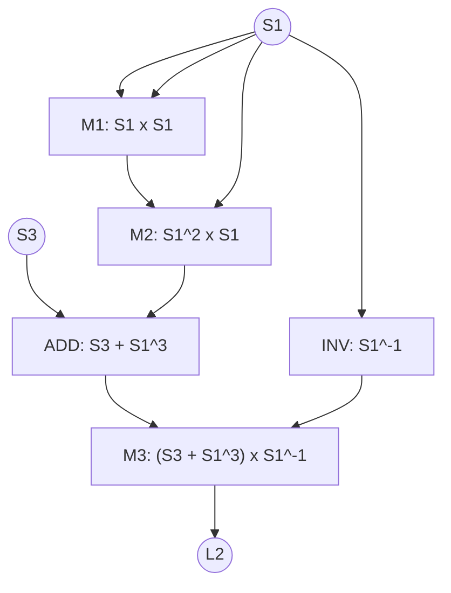
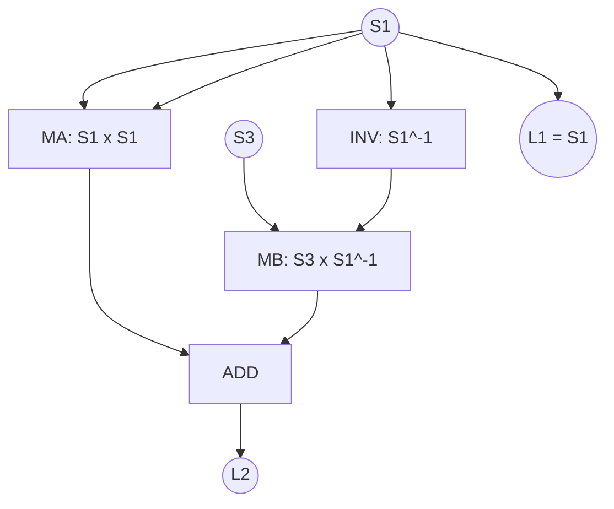
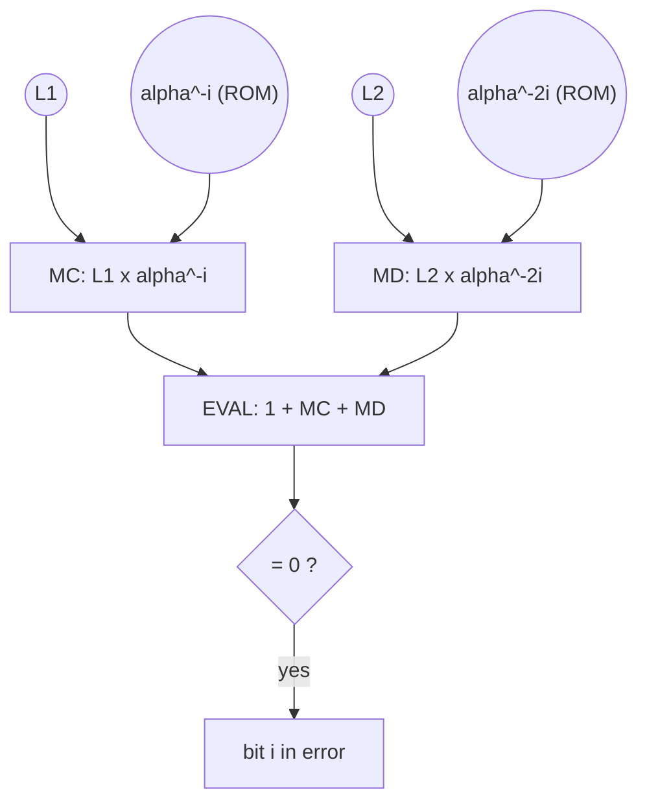
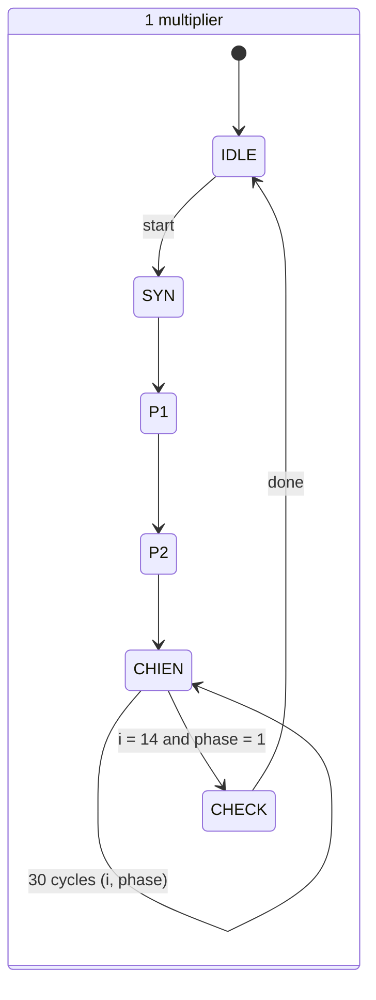
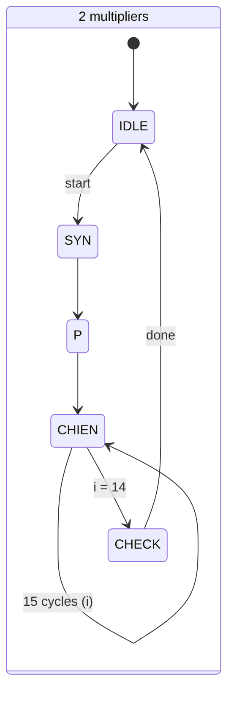

# Phase 4: BCH(15,7,2) Decoder by Hand HLS (1 vs. 2 GF Multipliers)

**Deliverable:** "BCH syndrome + Peterson error locator in GF(2⁴) from your own hand HLS (1 vs. 2 GF multipliers)."

**Result:**
- Two decoders, `bch_dec_1mul` and `bch_dec_2mul`, each synthesised with either multiplier from Phase 3.
- All 4 configurations match the golden model on all 17,488 test vectors.
- **2 multipliers:** 18 cycles. **1 multiplier:** 34 cycles.
- The 2-multiplier decoder costs only 6–15 more LUTs, so it has the better area × time product.

New terms (DFG, ASAP, ALAP, binding, …) are explained in the [Glossary](Glossary.md#9-hand-hls-high-level-synthesis).

---

## 1. What the decoder computes

The input is a received 15-bit word r: a BCH codeword with up to 2 flipped bits. The outputs are:
- the error mask
- the corrected codeword
- `ok`, which is 0 if the errors could not be corrected
- every intermediate value (S1, S3, Λ1, Λ2), so each stage can be checked against `bch_dec.mem`

| Step | Maths | Operations |
|------|-------|------------|
| Syndromes | S1 = r(α), S3 = r(α³) | XOR of constants only. No multiplier |
| Peterson | Λ1 = S1, Λ2 = (S3 + S1³) / S1 | GF multiplications, 1 inverse, XOR |
| Chien search | bit i is wrong ⇔ Λ(α⁻ⁱ) = 1 + Λ1·α⁻ⁱ + Λ2·α⁻²ⁱ = 0, for i = 0..14 | 2 GF multiplications per position (30 in total) |
| Check | `ok` ⇔ number of roots = deg Λ (special case S1 = 0: `ok` ⇔ S3 = 0) | Compare |

**Resource and timing model** (the assumptions the schedule is built on):

| Operation | Hardware | Time |
|-----------|----------|------|
| GF multiply | `gf16_mul` (Phase 3 block). **This is the constrained resource: 1 or 2 units** | 1 control step |
| GF inverse | `gf16_inv_sop` (4 LUTs) | Chained combinationally before a multiply in the same step |
| GF add | 4 XOR gates | Chained in the same step |
| Syndromes | `bch_syndrome` XOR network | 1 step |
| α⁻ⁱ, α⁻²ⁱ | `bch_chien_x` lookup table | Chained (read in the same step) |

---

## 2. Data-flow graph and an algebraic transformation

### 2.1 Peterson, original form

Λ2 = (S3 + S1³) / S1 needs S1², then S1³, then the division. That is a **chain of three multiplications**:



Every operation lies on the critical path (mobility 0). It needs **3 steps, however many multipliers are available**, so a second multiplier would buy nothing.

### 2.2 Peterson, transformed form (used in the RTL)

Expanding the fraction gives **Λ2 = S3·S1⁻¹ + S1²**. The two products no longer depend on each other:



This is the first hand-HLS decision: **restructure the algorithm so that it has parallelism worth buying hardware for.** It also cuts the number of multiplications from 3 to 2.

### 2.3 Chien search (repeated for i = 0..14)



α⁻²ⁱ is read from the lookup table rather than computed as (α⁻ⁱ)². That removes a multiplication from every position.

---

## 3. ASAP / ALAP and mobility

These use unit-time multiplications, with the inverse and XOR chained into the same step.

| Operation | ASAP step | ALAP step (2-step bound) | Mobility |
|-----------|-----------|--------------------------|----------|
| MA = S1·S1 | 1 | 2 | 1 |
| MB = S3·S1⁻¹ | 1 | 2 | 1 |
| L2 = MA + MB | 1 (chained) | 2 (chained) | 1 |
| MC(i) = L1·α⁻ⁱ | 1 | 2 | 1 |
| MD(i) = L2·α⁻²ⁱ | 1 | 2 | 1 |

- **Unlimited resources (ASAP):** Peterson takes 1 step and each Chien position takes 1 step. Two multipliers are enough to reach this.
- **One multiplier:** each pair of independent multiplications has to be serialised. List scheduling (priority = least mobility, ties broken by program order) places MA in step 1 and MB in step 2. For Chien, it places MC(i) then MD(i).

---

## 4. Resource-constrained schedules

### 4.1 One multiplier (`bch_dec_1mul`): 34 cycles

| Cycle | State | Multiplier M | Other work | Registers written |
|-------|-------|--------------|------------|-------------------|
| 0 | IDLE | – | sample `start` | r_q ← r |
| 1 | SYN | – | syndrome XOR network | S1, S3 |
| 2 | P1 | S1 · S1 | – | L1 ← S1, L2 ← M |
| 3 | P2 | S3 · S1⁻¹ | inverse chained before M | L2 ← L2 ⊕ M |
| 4 + 2i | CHIEN, phase 0 | L1 · α⁻ⁱ | ROM lookup | acc ← 1 ⊕ M |
| 5 + 2i | CHIEN, phase 1 | L2 · α⁻²ⁱ | root test acc ⊕ M = 0 | mask[i], roots |
| 34 | CHECK | – | roots = deg Λ ? | ok, done (mask cleared if not ok) |

i runs from 0 to 14, so the Chien search covers cycles 4–33 (30 cycles).

### 4.2 Two multipliers (`bch_dec_2mul`): 18 cycles

| Cycle | State | Multiplier MA | Multiplier MB | Other work | Registers written |
|-------|-------|---------------|---------------|------------|-------------------|
| 0 | IDLE | – | – | sample `start` | r_q ← r |
| 1 | SYN | – | – | syndrome XOR network | S1, S3 |
| 2 | P | S1 · S1 | S3 · S1⁻¹ | inverse chained before MB | L1 ← S1, L2 ← MA ⊕ MB |
| 3 + i | CHIEN | L1 · α⁻ⁱ | L2 · α⁻²ⁱ | root test 1 ⊕ MA ⊕ MB = 0 | mask[i], roots |
| 18 | CHECK | – | – | roots = deg Λ ? | ok, done |

i runs from 0 to 14, so the Chien search covers cycles 3–17 (15 cycles).

### 4.3 Binding (multiplier operand selection)

| Control step | 1 multiplier: (a, b) of M | 2 multipliers: MA (a, b) | 2 multipliers: MB (a, b) |
|--------------|---------------------------|--------------------------|--------------------------|
| P1 / P | (S1, S1) | (S1, S1) | (S3, S1⁻¹) |
| P2 | (S3, S1⁻¹) | – | – |
| CHIEN | phase 0: (L1, α⁻ⁱ), phase 1: (L2, α⁻²ⁱ) | (L1, α⁻ⁱ) | (L2, α⁻²ⁱ) |

In hardware:
- With **1 multiplier**, each operand needs a 4-way multiplexer.
- With **2 multipliers**, each operand needs only a 2-way multiplexer.

That is why the area saved by sharing is smaller than one whole multiplier.

### 4.4 Register allocation

| Register | Bits | Live during | Notes |
|----------|------|-------------|-------|
| r_q | 15 | whole decode | Received word. Also used for `corrected = r_q ⊕ mask` |
| S1, S3 | 4 + 4 | SYN → CHECK | Outputs, also needed by CHECK |
| L1, L2 | 4 + 4 | P → CHECK | Outputs. With 1 multiplier, **L2 doubles as the accumulator** between P1 and P2, so no extra register is needed |
| acc | 4 | between Chien phases | **1 multiplier only:** holds 1 + L1·α⁻ⁱ until L2·α⁻²ⁱ is ready |
| phase | 1 | Chien | **1 multiplier only** |
| i | 4 | Chien | Position counter, also the address of the lookup table |
| roots | 2 | Chien → CHECK | A degree-2 locator has at most 2 roots |
| err_mask | 15 | Chien → output | |
| ok, done, state | 1 + 1 + 3 | | |

The 1-multiplier decoder needs **5 more flip-flops** (acc + phase). Synthesis confirms this: 62 FFs against 57.

### 4.5 Controllers





### 4.6 Design decisions worth noting

- **Constant-time decoding.** The latency is always 34 or 18 cycles, whatever the error pattern. The S1 = 0 case needs no separate branch: L1 = L2 = 0 makes Λ = 1, which has no roots, so CHECK decides on S3 alone. Timing therefore reveals nothing about the number of errors, which is a sensible property in a security block.
- **No multipliers outside the Peterson and Chien steps.** The syndromes are XOR networks, and α⁻²ⁱ comes from a lookup table.
- **Same interface for both decoders**, so the fuzzy extractor (Phase 5) can use either one.
- **Multiplier choice is a parameter.** `USE_SOP = 1` selects the ESPRESSO block and `0` selects the XOR block, through the `gf16_mul` wrapper.

---

## 5. Verification

The testbench is `tb/tb_bch_dec.v`. It runs four decoders side by side on every vector of `model/vectors/bch_dec.mem` and compares S1, S3, Λ1, Λ2, the error mask, the corrected word and `ok`:
- 15,488 vectors: every codeword with every error pattern of weight ≤ 2
- 2,000 vectors: random weight-3 patterns

| DUT | Architecture | Multiplier | Latency | Mismatches |
|-----|--------------|------------|---------|------------|
| 0 | 1 GF multiplier | ESPRESSO | 34 (constant) | 0 / 17,488 |
| 1 | 1 GF multiplier | XOR | 34 (constant) | 0 / 17,488 |
| 2 | 2 GF multipliers | ESPRESSO | 18 (constant) | 0 / 17,488 |
| 3 | 2 GF multipliers | XOR | 18 (constant) | 0 / 17,488 |

Simulator output: `PASS: all 4 decoders match the golden model on 17488 vectors`.

**Mutation test (does the testbench actually catch bugs?).** In a scratch copy of the 1-multiplier decoder, the P2 step was changed from `L2 <= L2 ^ M` to `L2 <= L2`. The testbench reported mismatches from the second vector onwards, and the comparison pointed straight at the faulty stage (S1 and S3 correct, Λ2 wrong). The mutant also shows why the fuzzy extractor needs the key-check value: the broken decoder still reported `ok = 1`, but with the wrong error mask.

---

## 6. Synthesis results (Vivado 2024.2, Zynq-7010, out-of-context)

These are post-synthesis estimates. f_max = 1 / (4 ns − WNS). The decode time is cycles / f_max. Reports are in `docs/reports/synth_bch/`.

### 6.1 Each block kept as a separate resource (`-flatten_hierarchy none`)

This matches the allocation assumed by the HLS schedule.

| Decoder | Multiplier | LUTs | FFs | f_max | Cycles | Decode time | LUTs × ns |
|---------|------------|------|-----|-------|--------|-------------|-----------|
| 1 multiplier | ESPRESSO | **110** | 62 | 158.5 MHz | 34 | 214.5 ns | 23,595 |
| 2 multipliers | ESPRESSO | **125** | 57 | 161.8 MHz | 18 | **111.2 ns** | **13,900** |
| 1 multiplier | XOR | **101** | 62 | 171.1 MHz | 34 | 198.7 ns | 20,069 |
| 2 multipliers | XOR | **107** | 57 | 165.0 MHz | 18 | **109.1 ns** | **11,674** |

LUT breakdown, ESPRESSO version:

| Block | 1 multiplier | 2 multipliers |
|-------|--------------|---------------|
| Control, registers and multiplexers | 77 | 76 |
| Syndromes | 12 | 12 |
| Chien lookup table | 3 | 3 |
| Inverse | 2 | 2 |
| Multipliers | 16 | 2 × 16 |

### 6.2 Vivado default (`-flatten_hierarchy rebuilt`)

| Decoder | Multiplier | LUTs | FFs | f_max |
|---------|------------|------|-----|-------|
| 1 multiplier | ESPRESSO | 243 | 62 | 206.7 MHz |
| 2 multipliers | ESPRESSO | 144 | 57 | 177.9 MHz |
| 1 multiplier | XOR | 97 | 62 | 152.3 MHz |
| 2 multipliers | XOR | 111 | 57 | 173.0 MHz |

### 6.3 Conclusions

1. **Two multipliers win on area × time.** Halving the latency (34 → 18 cycles) costs only 15 LUTs with the ESPRESSO multiplier, or 6 with the XOR one. The area × time product is about 40% lower.
2. **Sharing saves less than one multiplier.** One GF(2⁴) multiplier is only 16 LUTs, and sharing it adds 4-way operand multiplexers plus the `acc` and `phase` registers. Sharing pays off only when the shared unit is large compared with the multiplexing it adds. For a 4-bit field it isn't; for a large field such as GF(2⁸) or GF(2¹⁶) it would be.
3. **Flattening can badly distort the SOP design.** With the default flattening, Vivado merges the 129-term ESPRESSO multiplier with its 4-way operand multiplexer and produces 243 LUTs, more than twice the hierarchical result. The XOR multiplier is unaffected (97 LUTs). This repeats the Phase 3 finding: the two-level SOP form doesn't suit LUT-based logic.
4. **Speed is not a concern.** Every configuration exceeds the 125 MHz system clock. At 125 MHz a full key (8 BCH blocks for r = 1) decodes in 8 × 34 × 8 ns ≈ 2.2 µs with 1 multiplier, or 1.2 µs with 2. One PUF measurement takes tens of milliseconds. **Recommended for the fuzzy extractor:** `bch_dec_2mul`. Use `USE_SOP = 1` where the ESPRESSO block must be shown, and `USE_SOP = 0` for the smallest design.

---

## 7. Files and how to run

| File | Contents |
|------|----------|
| `rtl/ecc/bch_syndrome.v` | S1, S3 XOR network |
| `rtl/ecc/bch_chien_x.v` | α⁻ⁱ, α⁻²ⁱ lookup table |
| `rtl/ecc/bch_dec_1mul.v` | Decoder, 1 shared GF multiplier, 34 cycles |
| `rtl/ecc/bch_dec_2mul.v` | Decoder, 2 GF multipliers, 18 cycles |
| `rtl/gf/gf16_mul.v` | Multiplier wrapper (`USE_SOP` selects ESPRESSO or XOR) |
| `tb/tb_bch_dec.v` | Self-checking testbench, 4 DUTs × 17,488 vectors |
| `scripts/synth_bch.tcl` | Vivado synthesis of all 8 configurations |
| `docs/reports/synth_bch/` | Utilization and timing reports, `summary.txt` |

To simulate from the command line, go to a folder that contains `bch_dec.mem`:

```sh
xvlog rtl/gf/gf16_mul_sop.v rtl/gf/gf16_mul_xor.v rtl/gf/gf16_inv_sop.v rtl/gf/gf16_mul.v \
      rtl/ecc/bch_syndrome.v rtl/ecc/bch_chien_x.v rtl/ecc/bch_dec_1mul.v rtl/ecc/bch_dec_2mul.v \
      tb/tb_bch_dec.v
xelab tb_bch_dec -s tb_bch
xsim tb_bch -R
```

To synthesise, run this from the project root:

```sh
vivado -mode batch -nojournal -nolog -source scripts/synth_bch.tcl
```
