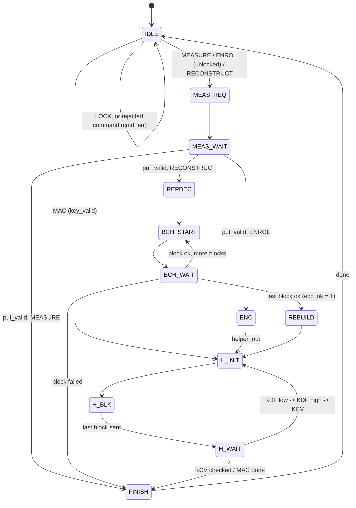

# Phase 5: Fuzzy Extractor in Hardware

**Goal:** the hardware key generator. It takes the 128-bit PUF response and the helper data, corrects the noise, and produces the 128-bit key with a `key_valid` flag. It also includes the enrol/reconstruct/measure sequencer with the one-time enrolment lock (objectives O6 and O7).

**Result:**
- `rtl/fe/fuzzy_extractor.v` is a bit-exact hardware version of `model/fuzzy_extractor.py`.
- It matches the golden model on every vector for all three repetition factors (r = 1, 3, 5): enrolment, lock, reconstruction, key check and MAC.
- It meets the 125 MHz system clock after place and route.
- Size: 1,233–1,519 LUTs, 7–9% of the Zynq-7010.

| Step | Block | Status |
|------|-------|--------|
| 5.1 | SipHash-2-4 core: KDF, key-check value, MAC | ✅ |
| 5.2 | BCH encoder + repetition encoder/decoder | ✅ |
| 5.3 | Fuzzy-extractor datapath (enrol, reconstruct) | ✅ |
| 5.4 | Sequencer FSM with one-time lock | ✅ |
| 5.5 | End-to-end verification against `fe_r1/3/5.mem` | ✅ |

---

## 5.1 SipHash-2-4 core (`rtl/crypto/siphash24.v`)

### Why SipHash, and where it is used

SipHash-2-4 is a keyed hash with a 128-bit key and a 64-bit output. It's built only from 64-bit additions, rotations and XORs, which suits FPGA logic well. One core covers all three cryptographic jobs in the design:

| Use | Key | Message | Blocks |
|-----|-----|---------|--------|
| KDF, low half of K | fixed public `KDF_KEY` | 0x01 ‖ corrected response bytes (16 / 13 / 11 bytes for r = 1 / 3 / 5) | 3 / 2 / 2 |
| KDF, high half of K | fixed public `KDF_KEY` | 0x02 ‖ corrected response bytes | 3 / 2 / 2 |
| Key-check value (KCV) | K | `"KCV"` (3 bytes) | 1 |
| MAC tag | K | 64-bit challenge (8 bytes) | 2 |

### Architecture

The core runs one SipRound per clock, and **every round goes from register to register**:

```
 init: v0..v3 = key ^ constants
 block: v3 ^= m  ──► round ──► round, v0 ^= m ──┬──► IDLE (more blocks)
                                                └──► v2 ^= 0xff ──► 4 rounds ──► tag = v0^v1^v2^v3
```

- **Latency:** a message of B blocks takes **3B + 5 cycles** from its first block to `tag_valid`.

| Job | Blocks | Cycles | Time at 125 MHz |
|-----|--------|--------|-----------------|
| MAC | 2 | 11 | 88 ns |
| KCV | 1 | 8 | 64 ns |
| One half of the KDF (r = 1) | 3 | 14 | 112 ns |

- **Interface:** `init` + `key`, then `blk_valid` + `blk` + `blk_last`, then `tag_valid` + `tag`, with a `ready` handshake.
  - The caller formats the final block (remaining bytes + length byte), as the SipHash specification defines.
  - Byte order matches the reference implementation and `model/siphash.py` (little-endian).
- **Key isolation:** the key only enters through the `key` port and leaves only as a hash.

**Design iteration (timing).** The first version chained "v3 ^ message" into the first round, and the final XOR into the last round. That saved 3 cycles per message, and the core met 125 MHz on its own with +0.29 ns of slack after routing. Inside the fuzzy extractor, though, the block and key multiplexers in front of the core added levels to that path. The integrated design then failed at −0.54 ns: a 21-level path from the FSM's `job` register through the multiplexer and a full round to `tag_reg`.

Moving the message XOR and the tag XOR into their own clock cycles made every round start and end in a register. That fixed timing for every configuration and cost only a few cycles per message.

### Verification

The testbench is `tb/tb_siphash24.v`, with vectors in `model/vectors/siphash.mem` (278 in total):

| Group | Count | Source |
|-------|-------|--------|
| Reference vectors (key 00..0F, message 00 01 … n−1, n = 0..63) | 64 | The SipHash reference test set. Vector 2 was spot-checked against the official table |
| Random keys and messages (0–63 bytes) | 200 | Golden model |
| Design messages: KDF (r = 1/3/5, both halves), KCV, MAC | 14 | Golden model, formatted exactly as the fuzzy extractor uses them |

**Result:** `PASS: siphash24 matches all 278 vectors …`, with latency exactly 3B + 5 cycles.

**Mutation test:** changing one rotation from 13 to 12 bits made the testbench fail from the first vector.

### Synthesis (core on its own, 125 MHz constraint)

| LUTs | FFs | CARRY4 | Logic levels | Slack after synthesis | Estimated f_max |
|------|-----|--------|--------------|-----------------------|-----------------|
| 659 | 397 | 64 | 28 | +0.786 ns | 138.6 MHz |

---

## 5.2 BCH encoder and repetition codec

| Module | Function | Implementation |
|--------|----------|----------------|
| `rtl/ecc/bch_enc.v` | 7-bit message → 15-bit systematic codeword: cw = {msg, msg·x⁸ mod g(x)} | LFSR division unrolled into an XOR network |
| `rtl/ecc/rep_codec.v` → `rep_encode` | Each data bit repeated REP times (bit j → code bits j·REP … j·REP+REP−1) | Wiring only |
| `rtl/ecc/rep_codec.v` → `rep_decode` | Majority vote over each group of REP copies | One LUT per bit |

The testbench is `tb/tb_ecc_blocks.v`, and every possible input is tested:
- `bch_enc`: 128/128 against `bch_enc.mem`
- `rep_decode`: every input pattern for REP = 1, 3, 5
- `rep_encode` → `rep_decode` round trip

Result: **PASS**.

---

## 5.3 Fuzzy-extractor datapath

The datapath follows the golden model step by step. Parameters derived from REP:

| REP | Bits per BCH block | BCH blocks | Response bits used | KDF message | SipHash blocks per KDF half |
|-----|--------------------|-----------|--------------------|-------------|-----------------------------|
| 1 | 15 | 8 | 120 | 16 bytes | 3 |
| 3 | 45 | 2 | 90 | 13 bytes | 2 |
| 5 | 75 | 1 | 75 | 11 bytes | 2 |

**Enrolment:**

```
 w (PUF) ─┬──────────────────────────────────────► XOR ──► helper_out
          │  enrol_msg ─► bch_enc x NBLK ─► rep_encode ─┘
          └──► KDF: SipHash(KDF_KEY, 0x01‖w), SipHash(KDF_KEY, 0x02‖w) ─► K ─► SipHash(K,"KCV") ─► kcv_out
                                                                         K is then zeroised
```

**Reconstruction:**

```
 w' (PUF) ─► XOR helper ─► rep_decode ─► bch_dec_2mul, one block at a time ─► all ok? ── no ──► FAIL
                                                                                │ yes
               helper ─► XOR ◄─ rep_encode ◄─ corrected codewords ◄─────────────┘
                          │ (exact w)
                          └──► KDF ─► K ─► SipHash(K,"KCV") == kcv_in ? ── yes ─► key_valid = 1
                                                                       └─ no ──► K zeroised
```

Design choices:
- **One BCH decoder, reused.** The Phase 4 `bch_dec_2mul` decodes the blocks one after another. Even for r = 1 (8 blocks) that's only about 150 cycles.
- **Enrolment messages come in on a port** (`enrol_msg`). In the lab they come from the PC. A product would use an on-chip random-number generator; this is documented as a limitation.
- **No secret appears on any port.** The response w, the key K and the internal codewords live only in internal registers. `raw_resp` carries data only in the `CHARACTERISATION = 1` build, used for collecting PUF statistics.
- **Zeroisation.** Clearing data that could reveal secrets:
  - **K:** cleared at the start of every enrolment or reconstruction, after enrolment, and when a key check fails.
  - **w, `rx_q`, `cw_q`:** cleared at the end of every command. The codewords XOR the helper data would give back w.

---

## 5.4 Sequencer FSM and one-time lock

### Command interface

| `cmd` | Command | Accepted when | Effect |
|-------|---------|---------------|--------|
| 1 | MEASURE | always | One PUF measurement. Raw value shown only in the characterisation build |
| 2 | ENROL | `!locked` | Helper data + KCV, then lock (AUTO_LOCK). **Rejected with `cmd_err` when locked** |
| 3 | RECONSTRUCT | always | Rebuild K. `key_valid = 1` only if every BCH block decoded and the KCV matches |
| 4 | LOCK | always | Set the sticky lock bit |
| 5 | MAC | `key_valid` | tag = SipHash(K, challenge). **Rejected without a valid key** |

The PUF is connected through a simple request/response handshake (`puf_req`, then `puf_valid` + `puf_resp`). Workstream A's measurement unit plugs in directly.

### State machine



### Security rules built into the FSM

These will be proved formally in Phase 7:
1. **Key valid only after ECC success.** `key_valid` is set in exactly one place: after the key-check value has matched *and* `ecc_ok = 1`. `ecc_ok` is set only after the last BCH block decoded successfully. Both are cleared together when a new enrolment or reconstruction starts.
2. **No enrolment after lock.** ENROL is rejected while `locked = 1`. The lock is only ever set, never cleared, except by reset, where it is reloaded from `boot_locked`.
   - On a real product, `boot_locked` would come from a fuse or protected flash.
   - On the lab boards it is emulated, because the Zynq eFUSEs must not be programmed.
3. **No MAC without a valid key**, and **enrolment never leaves a usable key behind**.

---

## 5.5 Verification

The testbench is `tb/tb_fuzzy_extractor.v`, run once per repetition factor. For each of the 24 vectors in `fe_r<REP>.mem`, it plays out a full device life cycle:

| Step | Check |
|------|-------|
| ENROL (w, model's BCH messages) | `helper_out` and `kcv_out` equal the model. Lock set. No key left. Secrets wiped |
| ENROL again | Rejected (`cmd_err`), helper unchanged |
| MAC before reconstruction | Rejected |
| RECONSTRUCT (noisy w′) | `key_valid` and the internal key equal the model (cases 20–23: another board's response → must fail). `key_valid` implies `ecc_ok` and `kcv_ok`. Secrets wiped |
| MAC (vector's challenge) | Tag equals the model, or the command is rejected if the reconstruction failed |
| Vector 0 only: RECONSTRUCT with a corrupted KCV | ECC succeeds, but the key is refused and zeroised |
| After the loop: reset with `boot_locked = 1` | ENROL rejected. LOCK is idempotent |

**Results:**

| REP | Vectors | Result | ENROL latency | RECONSTRUCT latency |
|-----|---------|--------|---------------|---------------------|
| 1 | 24 | ✅ PASS | 52 cycles | 213 cycles (1.7 µs) |
| 3 | 24 | ✅ PASS | 46 cycles | 87 cycles (0.7 µs) |
| 5 | 24 | ✅ PASS | 46 cycles | 67 cycles (0.5 µs) |

Latencies include the testbench's 5-cycle PUF stand-in. The real RO measurement adds milliseconds.

**Mutation tests (are the security checks really tested?):**

| Mutant | Caught by |
|--------|-----------|
| Lock check removed (ENROL allowed while locked) | "second enrolment accepted", from vector 0 |
| KCV comparison removed (any decoded key accepted) | "wrong KCV not rejected" |

The second mutant passes every model vector, because the vectors never contain a case where ECC succeeds but the key is wrong. Only the dedicated wrong-KCV test catches it, which is why that test is in the testbench.

---

## 5.6 Synthesis and timing (Zynq-7010, 125 MHz)

| REP | LUTs | FFs | LUT % of device | Slack after synthesis | **Slack after place and route** |
|-----|------|-----|-----------------|-----------------------|---------------------------------|
| 1 | 1,519 | 1,460 | 8.6% | +0.786 ns | **+0.259 ns** |
| 3 | 1,306 | 1,145 | 7.4% | +0.786 ns | **+0.459 ns** |
| 5 | 1,233 | 1,063 | 7.0% | +0.786 ns | not run |

Area breakdown (LUTs, from the hierarchical utilization report):

| REP | SipHash | BCH decoder* | Rest (repetition codec, BCH encoders, sequencer, registers) |
|-----|---------|--------------|--------------------------------------------------------------|
| 1 | 856 | 374 | 289 |
| 3 | 826 | 246 | 234 |
| 5 | 814 | 217 | 202 |

\* Includes the multiplexer that selects the current block (8 blocks for r = 1).

**Notes:**
- **SipHash dominates the area:** 56–66% of the LUTs. Most flip-flops hold the 128-bit response, helper, key and codeword registers.
- **The critical path is now one SipRound inside the core**, register to register. If the full SoC gets tight on timing, the next step is a half-round per clock (one 64-bit addition deep).
- **Reports:** `docs/reports/synth_fe/` and `docs/reports/synth_siphash/`.

---

## 5.7 Files and how to run

| File | Contents |
|------|----------|
| `rtl/crypto/siphash24.v` | SipHash-2-4 core |
| `rtl/ecc/bch_enc.v`, `rtl/ecc/rep_codec.v` | BCH encoder, repetition encoder/decoder |
| `rtl/fe/fuzzy_extractor.v` | Datapath + sequencer + lock |
| `tb/tb_siphash24.v`, `tb/tb_ecc_blocks.v`, `tb/tb_fuzzy_extractor.v` | Self-checking testbenches |
| `model/vectors/siphash.mem`, `fe_r1/3/5.mem`, `bch_enc.mem` | Golden-model vectors |
| `scripts/synth_siphash.tcl`, `scripts/synth_fe.tcl` | Synthesis |

To simulate the fuzzy extractor, run this from a folder that contains `fe_r1.mem`, `fe_r3.mem` and `fe_r5.mem`. `elab_r3.opt` holds the single line `tb_fuzzy_extractor -generic_top "REP=3" -s tb_fe3`. The options file avoids a Windows batch-file problem with the `=` sign.

```sh
xvlog rtl/gf/gf16_mul_sop.v rtl/gf/gf16_mul_xor.v rtl/gf/gf16_inv_sop.v rtl/gf/gf16_mul.v \
      rtl/ecc/bch_syndrome.v rtl/ecc/bch_chien_x.v rtl/ecc/bch_dec_2mul.v rtl/ecc/bch_enc.v \
      rtl/ecc/rep_codec.v rtl/crypto/siphash24.v rtl/fe/fuzzy_extractor.v tb/tb_fuzzy_extractor.v
xelab -f elab_r3.opt
xsim tb_fe3 -R
```

In the Vivado GUI, set the generic `REP` on `tb_fuzzy_extractor` under Simulation Settings, and add the `.mem` files as simulation sources.

To synthesise, run from the project root:

```sh
vivado -mode batch -nojournal -nolog -source scripts/synth_siphash.tcl
vivado -mode batch -nojournal -nolog -source scripts/synth_fe.tcl
```
