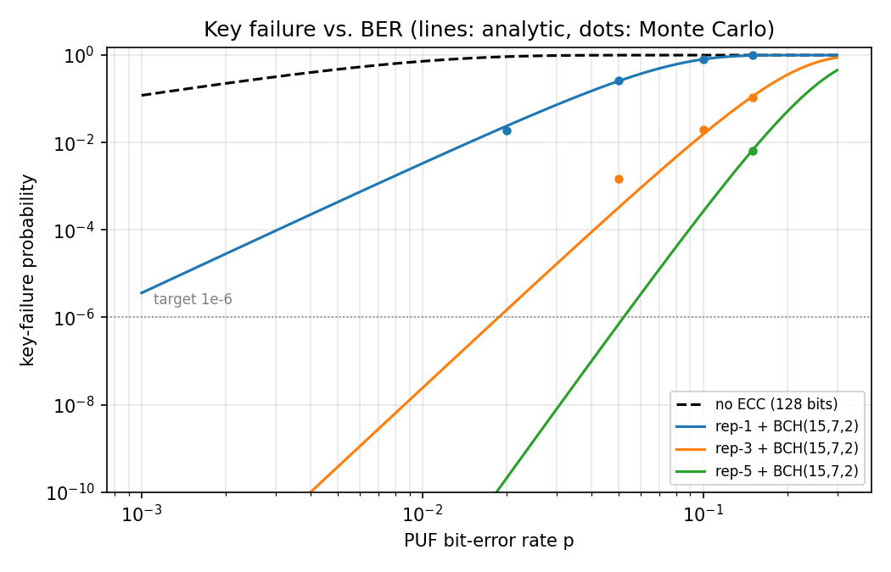
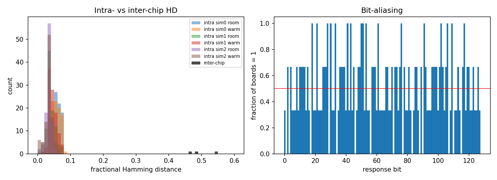

# Golden Model: RO-PUF Key Generator with Fuzzy Extractor

> **Project:** P4. Ring-Oscillator PUF Key Generator with Fuzzy Extractor (Hardware Security)
> **Target:** Zybo Z7-10 (Zynq-7010), Vivado
> **Status:** Golden model complete. All 32 unit tests pass. RTL test vectors generated.
> The overall project progress report is the top-level [`README.md`](../README.md).

The golden model is a Python reference version of the whole key generator. It has three jobs:

1. **Reference for the RTL.** It generates test vectors (inputs plus expected outputs) that the Verilog testbenches load with `$readmemh`, so every hardware block can be checked bit for bit.
2. **Choosing design parameters.** It predicts the key-failure rate for each repetition factor, so we can pick the right error correction once the real PUF bit-error rate is known.
3. **Analysing board measurements.** It computes uniqueness, reliability, bit-aliasing and key-failure rate from the RO-array data.

The model needs only Python 3.8+, numpy and matplotlib.

> New to a term (GF, syndrome, fuzzy extractor, CTL…)? See the project glossary: [`docs/Glossary.md`](../docs/Glossary.md).

---

## 1. What the model does

```
 ENROLMENT (once)                                RECONSTRUCTION (every power-up)

 PUF response w (128 bit)                        noisy re-read w' (128 bit)
        │                                                │
        │      random msg m ─► BCH(15,7) encode          │
        │                      ─► repeat each bit r×     │
        │                             │ c                │
        ▼                             ▼                  ▼
   w ─────────────── XOR ──────► helper h ──────────► XOR ─► c' = c + noise
        │                       (public, stored)         │
        │                                                ▼
        │                                     majority vote (repetition decode)
        │                                                ▼
        │                                     BCH decode: syndromes S1,S3
        │                                       → Peterson locator Λ(x)
        │                                       → Chien search → correct ≤2 errors/block
        │                                                ▼
        │                                     re-encode, XOR h  →  exact w
        ▼                                                ▼
   K = KDF(w) ──► KCV (public)                  K = KDF(w), accepted only if KCV matches
                                                         ▼
                                                key_valid, MAC(K, challenge) → tag
```

- **KDF** turns the corrected response into the 128-bit key (it uses SipHash-2-4).
- **KCV** (key-check value) is a short public fingerprint of the key. It lets the hardware confirm that the reconstructed key really is the enrolled one before it asserts `key_valid`.
- The key **never leaves the chip**. Only the MAC tag of a challenge is ever output.

---

## 2. Source files

| File | Purpose |
|------|---------|
| `gf16.py` | GF(2⁴) arithmetic with primitive polynomial p(x) = x⁴ + x + 1: bitwise multiplier (the same structure as the hardware), log/antilog tables, and inverse (inv(0) = 0) |
| `bch.py` | BCH(15,7,t=2): systematic encoder, syndromes S1/S3, Peterson error locator, Chien search and decoder-failure check. Every intermediate value is exposed for RTL checking |
| `repetition.py` | Repetition code: encode (each bit repeated r times) and majority-vote decode |
| `siphash.py` | SipHash-2-4, used as the keyed MAC and as the key-derivation function |
| `fuzzy_extractor.py` | Code-offset fuzzy extractor. `enrol()` returns helper data and the key. `reconstruct()` returns the key and `key_valid` |
| `noise.py` | Noise injection: random bit flips (binary symmetric channel) and directed flips |
| `puf_sim.py` | Behavioural RO-PUF board simulator (process variation, gradients, temperature, jitter). Used to test the analysis flow before real data exists |
| `analysis.py` | PUF metrics, analytic and Monte Carlo key-failure rates, and the measurement-file loader |
| `gen_vectors.py` | Writes the RTL test vectors and ESPRESSO truth tables (Section 4) |
| `failure_curves.py` | Plots key-failure rate against bit-error rate (Section 5.1) |
| `characterise.py` | Characterisation report from real or simulated boards (Section 5.2) |
| `bdd.py` | Our own ROBDD package (unique table, ITE, AND/OR/XOR), used to prove the ESPRESSO logic equivalent to the reference, plus a fast node counter for the variable-ordering study (Phase 3) |
| `tests/` | 32 unit tests covering every module |

---

## 3. Verification of the model

| Test | What is checked | Result |
|------|-----------------|--------|
| GF(2⁴) | Bitwise multiplier against log tables for all 256 input pairs. Commutativity, associativity and distributivity for all elements. a · a⁻¹ = 1 | ✅ Pass |
| BCH codewords | All 128 codewords are divisible by g(x), have zero syndromes and have minimum distance 5 | ✅ Pass |
| BCH decoding | **Exhaustive:** all 128 codewords × all 121 error patterns of weight ≤ 2 (15,488 cases) are corrected | ✅ Pass |
| BCH, 3 errors | 3,000 random weight-3 patterns are either flagged as failures or decoded to a *different* codeword. Neither is ever passed off as the original | ✅ Pass |
| SipHash-2-4 | Official reference vectors (empty message and 15-byte message) | ✅ Pass |
| Fuzzy extractor | Noiseless and maximum-correctable noise give the correct key for r = 1, 3, 5. A different board's response always gives `key_valid = 0`. A wrong key is never accepted as valid | ✅ Pass |
| Analysis | Monte Carlo agrees with the analytic formula (50,000 trials: 3.8 × 10⁻⁴ measured vs 3.2 × 10⁻⁴ predicted) | ✅ Pass |

Run all tests with `python -m unittest discover -s model/tests -t .`

---

## 4. Test vectors (`model/vectors/`)

Each `.mem` file is a plain-text file with one hex word per line. A Verilog testbench loads it with `$readmemh`, applies the input fields to the hardware block, and compares the outputs with the expected fields. Each file starts with a `//` header that gives the exact bit slice of every field.

```verilog
reg [67:0] vec [0:17487];
initial $readmemh("bch_dec.mem", vec);
// received = vec[i][66:52]; S1 = vec[i][51:48]; ... ok = vec[i][0];
```

### `gf_mul.mem`: GF(2⁴) multiplier (256 vectors, exhaustive)

| Bits | Field |
|------|-------|
| [11:8] | operand a |
| [7:4] | operand b |
| [3:0] | expected product a · b |

Example: the line `823` means a = 8 (α³), b = 2 (α), product = 3. That is α³ · α = α⁴ = α + 1 = `0011`.

### `gf_inv.mem`: GF(2⁴) inverse (16 vectors, exhaustive)

| Bits | Field |
|------|-------|
| [7:4] | input a |
| [3:0] | expected a⁻¹ (inv(0) = 0 by convention) |

### `bch_enc.mem`: BCH encoder (128 vectors, exhaustive)

| Bits | Field |
|------|-------|
| [22:16] | 7-bit message |
| [14:0] | expected 15-bit codeword: bits 14..8 are the message, bits 7..0 are the parity |

### `bch_dec.mem`: BCH decoder, step by step (17,488 vectors)

| Bits | Field | Decoder stage |
|------|-------|---------------|
| [66:52] | received word (codeword + errors) | input |
| [51:48] | S1 = r(α) | syndrome |
| [47:44] | S3 = r(α³) | syndrome |
| [43:40] | Λ1 | Peterson |
| [39:36] | Λ2 | Peterson |
| [34:20] | error mask (bit i set = bit i is wrong) | Chien search |
| [18:4] | corrected codeword | output |
| [0] | `ok`: 1 = decoding succeeded | output |

- **Lines 1–15,488:** every codeword with every error pattern of weight 0, 1 and 2. `ok` must be 1 and the corrected word must be the original.
- **Lines 15,489–17,488:** random weight-3 patterns, which test the failure detection.

Because every intermediate value is stored, a mismatch shows exactly which stage of the hardware decoder (syndrome, Peterson or Chien) is wrong.

### `fe_r1.mem`, `fe_r3.mem`, `fe_r5.mem`: full fuzzy extractor, end to end (24 vectors each)

There is one file per repetition factor r.

| Bits | Field |
|------|-------|
| [731:604] | w: enrolment PUF response (128 bits) |
| [603:548] | random BCH messages used at enrolment (7 bits per block) |
| [547:420] | helper data offset h = w ⊕ c |
| [419:388] | KCV (key-check value) |
| [387:260] | w′: re-read (noisy) PUF response |
| [259:132] | expected 128-bit key (0 if invalid) |
| [128] | expected `key_valid` |
| [127:64] | challenge |
| [63:0] | expected MAC tag (0 if invalid) |

| Cases | Scenario | Expected |
|-------|----------|----------|
| 0–3 | Same response, no noise | `key_valid = 1` |
| 4–7 | Exactly 2 errors in every BCH block (the maximum correctable) | `key_valid = 1` |
| 8–19 | Random noise, 3% bit-error rate | `key_valid = 1` in all generated cases |
| 20–23 | Response from a *different board* | `key_valid = 0`. This mirrors the final demo |

### `espresso/gf_mul.pla`, `espresso/gf_inv.pla`: ESPRESSO input

Full truth tables in ESPRESSO PLA format:
- the multiplier: 8 inputs a3..a0, b3..b0 → 4 outputs
- the inverse: 4 inputs → 4 outputs

They are the input to the logic-minimisation step (Phase 3) that builds the GF(2⁴) hardware block.

Regenerate every vector file with `python -m model.gen_vectors`.

---

## 5. Generated plots (`docs/figures/`)

### 5.1 Key-failure rate vs. PUF bit-error rate (`key_failure_vs_ber.png`)



**What it shows:** the probability that the key cannot be reconstructed, plotted against the PUF bit-error rate *p*, which is the fraction of response bits that flip between two reads.

- **Dashed black line:** no error correction. With 128 bits, even 0.1% noise makes about 12% of key reconstructions fail. Error correction is essential.
- **Coloured lines:** repetition code with r = 1, 3, 5 combined with BCH(15,7,2), computed analytically. Steeper and further to the right is more robust.
- **Dots:** Monte Carlo simulation of the actual model. They sit on the lines, which confirms both the maths and the code.
- **Dotted grey line:** the target failure rate of 1 in a million.

**What we learn:** where each curve crosses the target gives the highest bit-error rate that setting can tolerate.

| Rep factor r | BCH blocks | Response bits used | Max tolerable BER (at 10⁻⁶) | Key entropy left after helper data* |
|---|---|---|---|---|
| 1 | 8 | 120 | 0.07% | ≈ 56 bits |
| 3 | 2 | 90 | 1.87% | ≈ 14 bits |
| 5 | 1 | 75 | 5.21% | ≈ 7 bits |

\* Upper bound, assuming every response bit is fully random.

Typical RO-PUF bit-error rates are 1–5%, so r = 1 is too weak and r = 3 or more is likely needed. This shows the central **reliability vs. entropy trade-off** of the 128-bit design. The final r is chosen once the RO array's real bit-error rate is measured. Reducing that error rate is the goal of the research improvement (configurable ROs).

### 5.2 PUF characterisation (`sim_characterisation.png`)



> ⚠️ **This plot uses simulated boards with assumed parameters, not real measurements.** It demonstrates that the analysis flow works end to end. The same script produces the real version (`characterisation.png`) as soon as the RO-array data is available.

**Left: intra-chip vs. inter-chip Hamming distance.** This is the standard picture of PUF quality.
- **Coloured bars, near 0:** *intra-chip* distance. They show how much one board's response changes between reads, at room temperature and warm. Smaller is better, because the board recognises itself.
- **Black bars, near 0.5:** *inter-chip* distance. They show how different two boards' responses are. 0.5 is ideal, because boards look like independent random strings.
- A wide empty gap between the two groups means any board can be told apart from another with no ambiguity.

**Right: bit-aliasing.** For each of the 128 response bits, this is the fraction of boards on which that bit is 1. Ideally every bit hovers around 0.5 (red line). A bit that is 1 on *every* board in a large sample is biased by the layout, not by the chip, and carries no secret. With only 3 boards each bar can only be 0, ⅓, ⅔ or 1, and about 32 bits are equal on all boards by pure chance. The script reports that expected value alongside the measured one.

Simulated results (3 boards, 100 reads each, warm = +30 °C):

| Metric | Result | Ideal |
|--------|--------|-------|
| Uniqueness (mean inter-chip HD) | 50.0% (range 46.9–54.7%) | 50% |
| Reliability (mean intra-chip HD, room / warm) | 3.3–5.5% / 3.4–5.5% | 0% |
| Bit-aliasing (mean) | 0.503 | 0.5 |
| Key failure without ECC | 100% | 0% |
| Key failure with r = 3 + BCH | 0% (0 of ≈ 600 reconstructions) | 0% |

---

## 6. Conventions shared with the RTL

| Item | Convention |
|------|------------|
| Bit order | LSB first. Bit i of a vector is bit i of its integer or hex form |
| Response bit i | 1 if count(RO 2i) > count(RO 2i+1). A tie gives 0 |
| BCH codeword | Bits 14..8 are the message, bits 7..0 are the parity. g(x) = x⁸ + x⁷ + x⁶ + x⁴ + 1 |
| Concatenation | BCH block b occupies codeword bits 15b..15b+14. Each bit j is repeated r times at positions j·r..j·r+r−1 |
| Response bits used | The first 120 (r = 1), 90 (r = 3) or 75 (r = 5). The remaining bits are ignored |
| Key derivation | K = SipHash(KDF_KEY, 0x01‖w) \| SipHash(KDF_KEY, 0x02‖w) ≪ 64. w is packed LSB first. KDF_KEY = `"RO-PUF-KDF-v1"` padded with zeros to 16 bytes |
| KCV and tag | KCV = the low 32 bits of SipHash(K, `"KCV"`). Tag = SipHash(K, challenge as 8 bytes, little-endian) |

### Measurement file format (from the RO array)

Lay the data out as `data/<board>/room.txt` and `data/<board>/warm.txt`:
- One 128-bit response per line, written as 32 hex digits.
- Bit 0 is the LSB, which is RO pair 0.
- Lines starting with `#` are comments.
- The first line of `room.txt` is used as the enrolment reference.

---

## 7. How to run (from the project root)

```sh
python -m unittest discover -s model/tests -t .   # run all 32 tests
python -m model.gen_vectors                        # regenerate model/vectors/
python -m model.failure_curves                     # plot of Section 5.1
python -m model.characterise --simulate            # plot of Section 5.2 (simulated boards)
python -m model.characterise --data data           # same report from real board measurements
```

---

## 8. Next steps

- [ ] Characterise real boards with `characterise.py --data data` once the RO array produces responses, then fix the repetition factor r.
- [x] Phase 3: minimise `gf_mul.pla` and `gf_inv.pla` with ESPRESSO, verify with BDDs, and check the generated RTL against `gf_mul.mem` and `gf_inv.mem`. Results are in the top-level [`README.md`](../README.md#3-phase-3-gf2-arithmetic-via-espresso-and-bdd-completed).
- [x] Phase 4: hand-HLS BCH decoder (1 vs. 2 GF multipliers), verified against `bch_dec.mem`. See [`docs/Phase4_BCH_HLS.md`](../docs/Phase4_BCH_HLS.md).
- [x] Phase 5: fuzzy-extractor RTL verified against `fe_r*.mem`, and the SipHash core against `siphash.mem`. See [`docs/Phase5_Fuzzy_Extractor.md`](../docs/Phase5_Fuzzy_Extractor.md).
